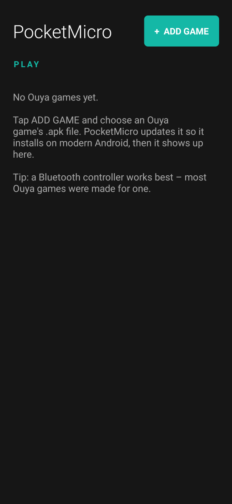
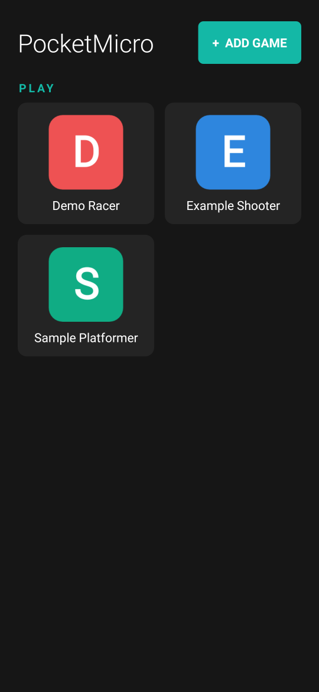
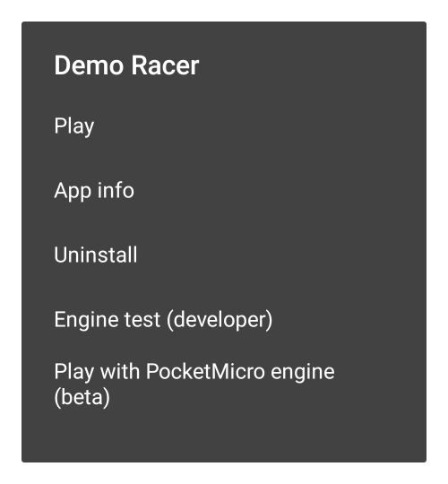

# PocketMicro

Play Ouya games on a modern Android phone.

> PocketMicro is an independent fan project. It is not affiliated with, endorsed by or connected
> to OUYA, Razer or any game publisher. "OUYA" is a trademark of its respective owner and is used
> here only to say which games the app works with. **No games are included.** Use it only with
> game files you are entitled to use. PocketMicro never unlocks paid content: games' own purchase
> checks are always left unchanged.

The Ouya ran Android 4.1, so its games are ordinary Android apps, but Android 14 and newer
refuse to install apps built for anything older than Android 6. PocketMicro fixes that: it
raises the game's target Android version (a single number inside the app's manifest), removes the
old signature, re-signs it with its own key and installs it.

Many Ouya games also contain only 32-bit ARM code, which newer 64-bit-only phones can't run.
For GameMaker: Studio 1.x games, PocketMicro has its own engine (beta) that runs that 32-bit code
on 64-bit phones.

## Getting started

**1. Install.** Download the newest APK from the [latest release](../../releases/tag/latest) and
open it on your phone.

**2. Add a game.** Copy an Ouya game's `.apk` to your phone, tap **+ ADD GAME** and choose it.
The first time, Android asks you to let PocketMicro install apps: allow it, then go back. Android
then asks you to confirm installing the game.

**3. Play.** Installed games appear in the library, along with any other app on the phone that
declares itself an Ouya game. Tap a game to start it. A Bluetooth controller works best: most
Ouya games were made for one.

**4. Game options.** Long-press a game for **App info**, **Uninstall**, and
**Play with PocketMicro engine (beta)**, which runs a GameMaker: Studio 1.x game's 32-bit code
on a 64-bit-only phone. *Engine test (developer)* boots the engine without a screen and reports
what happened, which is useful for bug reports.

*The screenshots are rendered from the app's own code off-device; the games in them are made-up
placeholders, not real titles.*

## Notes

- If you have the original (unpatched) game installed, uninstall it first: the signatures differ.
- Games that rely on the Ouya store or account services may not start. PocketMicro doesn't provide
  those services and won't bypass purchase checks.
- Games converted by PocketMicro are all signed with the same key (see `docs/signing.md`), so a
  game converted again later installs over the old copy and keeps its saves.

## Building

GitHub Actions builds the APK on every push to `main` and publishes it to the `latest` release.
Locally: `gradle assembleDebug` (needs the Android NDK and CMake 3.22+; the engine's dependencies
are downloaded by CMake). Screenshots: `gradle :app:testDebugUnitTest --tests '*Screenshots*'`.
`PLAN.md` describes how the engine works and how it got there.

## Credits

- **[apksig](https://android.googlesource.com/platform/tools/apksig/)** (Apache-2.0), Google's APK
  signing library, re-signs converted games.
- **[dynarmic](https://github.com/azahar-emu/dynarmic)** (0BSD), the ARM recompiler that runs
  32-bit game code in the engine, with its bundled libraries: fmt (MIT), mcl (0BSD), oaknut (MIT),
  robin-map (MIT), xbyak (BSD-3-Clause), Zycore and Zydis (MIT).
- **[Boost](https://www.boost.org)** headers (BSL-1.0), via the Azahar project's `ext-boost`, and
  **[zlib](https://zlib.net)** (zlib licence).
- **[Robolectric](https://robolectric.org)** (MIT) renders the tutorial screenshots in tests.

## AI use

PocketMicro was built with heavy use of AI. Most of its code and documentation was written by
Anthropic's Claude, working from my direction, testing and review. It has been tested on a real
phone with real games, but it hasn't had the years of use that long-established software has,
so please report anything that doesn't work.

## Licence

PocketMicro is free software: you can redistribute it and/or modify it under the terms of the
GNU General Public License as published by the Free Software Foundation, either version 3 of the
License, or (at your option) any later version. It is distributed WITHOUT ANY WARRANTY; see
[LICENSE](LICENSE) for the full text.

Copyright (C) 2026 Hcode91

Third-party components keep their own licences, listed under Credits.
