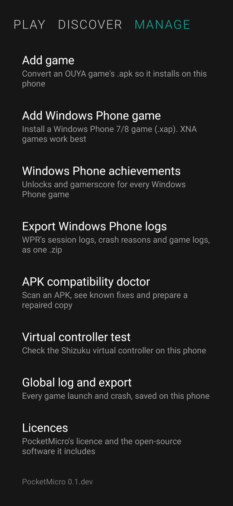
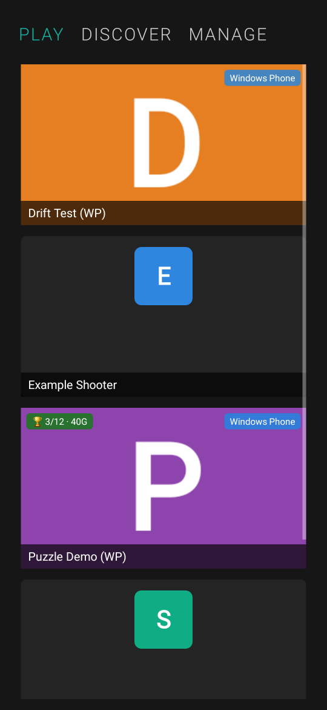
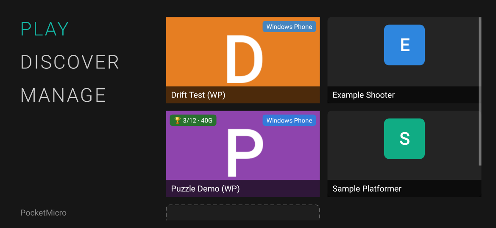
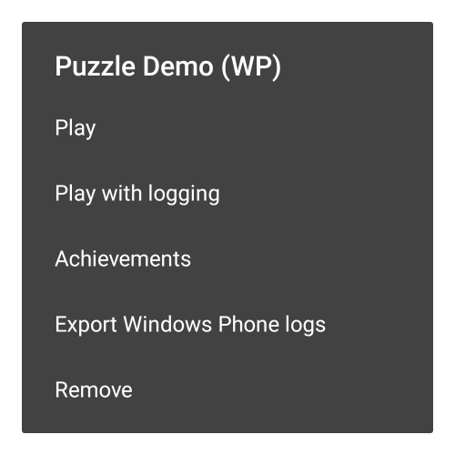

# PocketMicro

Play OUYA games on a modern Android phone. (This project was called PocketOuya until November 2026.)

> PocketMicro is an independent fan project. It is not affiliated with, endorsed by or connected
> to OUYA, Razer, Microsoft or any game publisher. "OUYA" and "Windows Phone" are trademarks of
> their respective owners, used here only to say which games the app works with. **No games are
> included.** Use it only with game files you are entitled to use. PocketMicro never unlocks paid
> content: games' own purchase checks are always left unchanged.

The OUYA ran Android 4.1, so its games are ordinary Android apps, but current Android versions
refuse to install apps built for anything that old, and many of those games no longer start on a
modern phone. PocketMicro converts a game's original `.apk` so it installs and runs:

1. **Add game** and pick the game's original, complete `.apk`.
2. PocketMicro raises the app's target Android version, applies any known compatibility repairs,
   optionally adds on-screen controls, and re-signs it.
3. Android installs the converted copy and it appears in PocketMicro's library.

**Download:** the newest build is on the [latest release](../../releases/tag/latest).

## Getting started

**1. Install.** There are two builds; install one:
- **PocketMicro** (the [latest release](../../releases/tag/latest), or GitHub **Actions** →
  *Android APK* → artifact `PocketMicro-apk`) for OUYA games.
- **PocketMicro Windows Phone edition** (artifact `PocketMicro-WindowsPhone-apk`): everything
  above plus Windows Phone 7/8 games. It's bigger. Either one installs over the other.

**2. Add an OUYA game.** Copy the game's original, complete `.apk` to your phone, open **MANAGE →
Add game** and choose it. Pick the options you want (on-screen controls, cheat menu and so on),
then let Android install the converted copy. The first time, Android asks you to allow PocketMicro
to install apps.

**3. Play.** Games appear under **PLAY**: OUYA games, and Windows Phone games with a blue
*Windows Phone* badge (and their achievements, if they have any). Tap one to play. A Bluetooth
controller works best; see *Controls* below for the on-screen pad.

**4. Game options.** Long-press an OUYA game for **App info**, **Uninstall**, the beta
**GameMaker engine**, **Capture log + export APK** (for bug reports) and **Add OBB data file**.

**5. Store (optional).** **DISCOVER** browses an OUYA community server; downloads go through the
same conversion.

Turn the phone sideways for the console-style layout, which a controller can drive:

## Windows Phone games (Windows Phone edition)

The Windows Phone edition runs Windows Phone 7 and 8 games with the
[WPR](https://github.com/Bubbleshum/WPR) runtime built in. XNA games work best; Silverlight games
are partial; Unity and WP8 C++ games aren't supported yet. Only `.xap` files that aren't
copy-protected can be installed (not `.appx`, and not encrypted Store packages).

1. Copy the game's `.xap` to your phone.
2. Open **MANAGE → Add Windows Phone game** and choose it. WPR prepares the game, then it appears
   under **PLAY** with its tile and a *Windows Phone* badge.
3. Tap it to play. In the game, the **☰** button at the top left has **Back** (the phone's Back
   button, for gesture navigation) and **Quit** (tap twice), which lets the game close properly.
4. Long-press the game for **Play with logging**, **Achievements**, **Export Windows Phone logs**
   and **Remove** (which also deletes its saves). **MANAGE → Windows Phone achievements** lists
   every game's unlocks and gamerscore.
5. If a game doesn't start, run it once with **Play with logging**, then **Export Windows Phone
   logs**: the `.zip` has everything needed for a bug report.

More detail: [Windows Phone edition](winphone/README.md).

*The screenshots were rendered from the app's own code off-device; every game in them is a
made-up placeholder, not a real title.*

## Games confirmed working

Tested on a Galaxy S23 (Snapdragon 8 Gen 2). "Working" means the game installs, starts and plays;
it doesn't promise every feature or online service works. Games not listed may work too; they
just haven't been tested yet.

OUYA and GameStick games (31)

- A Ride into the Mountains
- A Space Shooter For 2 Bucks
- Abbaye des Morts
- Abbigale and the Monster
- Knightmare Tower: OUYA Edition
- Maldita Castilla
- Monocle Man
- Muffin Knight
- Vector
- Vertex Blaster
- Vertical Void DX
- Video Poker Duel
- Void Pyramid
- VolChaos
- VVVVVV
- Walthros
- War Daddy: War Harder
- Wild Season
- Wind-up Knight
- Word Shaker
- Wraithborne
- YOU DON'T KNOW JACK
- YuletideRush
- ZeptoRacer
- ZeptoRacer 3D
- Zipangu
- ZombTack
- Zombie Hearts Chicken
- Zombie Trek Driver Survival

Also from the GameStick: unwind, Zombie Kill of the Week.

Other old Android games

- BattleSea
- Blackjack
- N.O.V.A. 3
- Sudoku Challenge
- UNCHARTED: Fortune Hunter

## Requirements and limits

- OUYA games are 32-bit ARM. Your phone must still run 32-bit apps (for example the Snapdragon
  8 Gen 2 in the Galaxy S23); some newer 64-bit-only phones cannot.
- Compatibility differs per game. Many start and play; others need repairs that don't exist yet.
  Games that depend on the closed OUYA store or account servers may not work.
- If the original, unconverted game is installed, uninstall it first: the signatures differ.
  Back up any saves before uninstalling.
- [Shizuku](https://shizuku.rikka.app/) is optional. It enables the virtual controller, game
  installs without prompts and on-phone log capture.

## Controls

A physical Bluetooth controller works best. Converted games can also get an on-screen pad laid
out like the OUYA controller: two analogue sticks, d-pad, O/U/Y/A, L1/L2, R1/R2 and Menu.
**Hide pad** hides it; **Input** chooses how it reaches the game:

- **Auto** uses the game engine's own input route where PocketMicro knows one (OUYA Unity,
  GameMaker, Unreal Engine 3, Adobe AIR, Marmalade), otherwise the virtual controller.
- **Virtual controller (Shizuku)** creates a real Android controller named "OUYA Game Controller",
  so games that only accept a physical device see one. See [details](docs/virtual-controller.md).
- **Android gamepad** and **Keyboard** send gamepad or keyboard events inside the game.

More: [touch controls](docs/touch-controls.md).

## Other features

- **Store:** browse and download games from an OUYA community server. The default is
  [ouya.cweiske.de](http://ouya.cweiske.de), run by Christian Weiske with his open-source
  [stouyapi](https://github.com/cweiske/stouyapi). PocketMicro is not affiliated with it.
  Downloads go through the normal conversion. See [store](docs/store.md).
- **APK compatibility doctor:** scans an APK against your phone, lists known fixes and open
  issues, and can prepare a repaired copy. See [doctor](docs/apk-doctor.md).
- **Startup repairs:** fixes for specific engine builds (Unity, Marmalade, Adobe AIR and others)
  that crash on modern Android, matched by exact library fingerprints rather than game names.
  See [native runtime repair](docs/native-runtime-repair.md) and
  [shared compatibility rules](docs/shared-compatibility-rules.md).
- **Logs:** a global game log with full export, and crash capture through Shizuku or from a
  bug-report file. Nothing is uploaded. See [global log](docs/global-game-log.md) and
  [crash capture](docs/crash-capture.md).
- **OBB data files:** some games (Gameloft's, for example) keep their data in a separate `.obb`
  file. Long-press the game and choose **Add OBB data file (Shizuku)** to copy it into
  `Android/obb/<package>/`, which Android 13+ otherwise blocks.
- **Cheat menu (opt-in):** tick **Cheat menu (single-player games)** when converting a game
  to add a **Cheats** button to its touch controls. Like Cheat Engine, it searches the game's own
  memory for a value (exact, or unknown and narrowed by increased/decreased), then edits or
  freezes it, and saves cheats per game. No root: it only reads the game's own process. Meant for
  offline single-player play; don't use it on purchases or paid content.
- **Windows Phone edition (in progress):** a second APK from the same build, with the
  [WPR](https://github.com/Bubbleshum/WPR) runtime built in, for Windows Phone 7/8 games (XNA
  works best). Games are added under MANAGE and play from the same library, with their own log
  export. See [Windows Phone edition](winphone/README.md).
- **GameMaker engine (beta):** a built-in translated engine for some GameMaker games.

## Building

GitHub Actions builds the APK on every push (`.github/workflows/android.yml`). Locally, run
`gradle assembleDebug`. The host test suite is `gradle :app:testHost`. Signing is explained in
[docs/signing.md](docs/signing.md), and the development history in
[docs/development-log.md](docs/development-log.md).

## Credits

- **[WPR (Windows Phone Runner)](https://github.com/Bubbleshum/WPR)** by MediaExplorer (MIT),
  with its own components (FNA, SDL, FAudio, FFmpeg and others): the Windows Phone runtime in the
  Windows Phone edition, via PocketMicro's fork [WPR-droid](https://github.com/Hcode91/WPR-droid).
- **[stouyapi](https://github.com/cweiske/stouyapi)** and the
  [ouya.cweiske.de](http://ouya.cweiske.de) community server by Christian Weiske, for the Store.
- **[Shizuku](https://shizuku.rikka.app/)** API (Apache-2.0) by RikkaApps.
- **[dexlib2/smali](https://github.com/JesusFreke/smali)** (BSD-3-Clause), **apksig**
  (Apache-2.0) and **Guava** (Apache-2.0), used to convert and re-sign games.
- **[dynarmic](https://github.com/azahar-emu/dynarmic)** (0BSD) and **Boost** (BSL-1.0) in the
  GameMaker engine.

The full notices are in the app under **MANAGE → Licences**.

## AI use

PocketMicro was built with heavy use of AI. Most of its code and documentation was written by
Anthropic's Claude, working from my direction, testing and review on a real phone with real games.
It hasn't had the years of use that long-established software has, so please report anything
that doesn't work.

## Licence

PocketMicro is free software: you can redistribute it and/or modify it under the terms of the
GNU General Public License as published by the Free Software Foundation, either version 3 of the
License, or (at your option) any later version. It is distributed WITHOUT ANY WARRANTY; see
[LICENSE](LICENSE) for the full text.

Copyright (C) 2026 Hcode91

Third-party components keep their own licences: Shizuku API (Apache-2.0), dexlib2/smali
(BSD-3-Clause), apksig (Apache-2.0), Guava (Apache-2.0), dynarmic (0BSD) and Boost (BSL-1.0).
OUYA is a trademark of its respective owner.

## Starting a game from another app

Launchers and trackers (such as BacklogQuest's home-screen tiles) can start a game directly: send
`com.hcode91.pocket.LAUNCH_GAME` to the app's launcher activity with the extra `game_id`: the
game's package name, its `wp:` id for a Windows Phone game, or its name as the library shows it
(any case).
